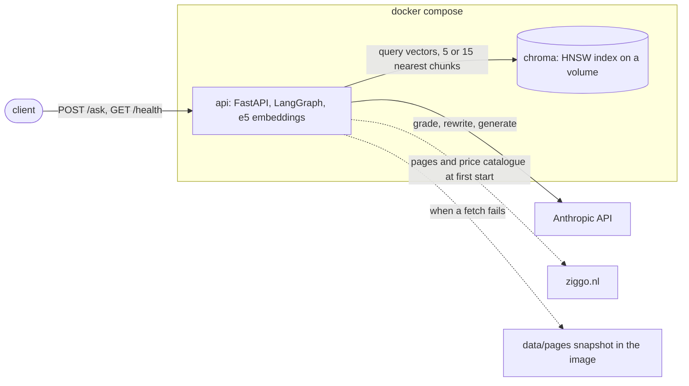
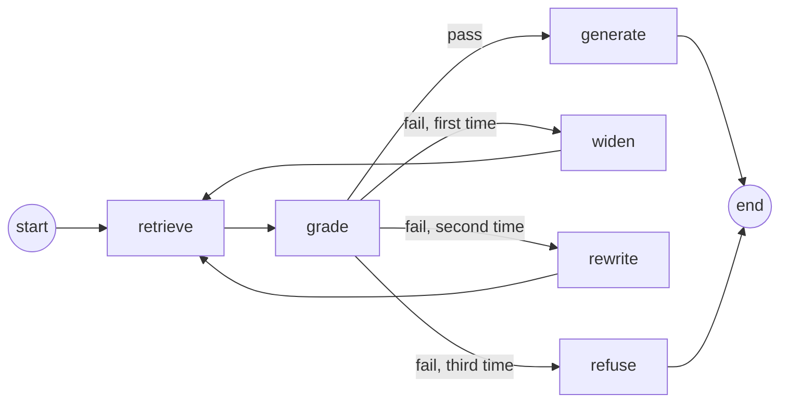
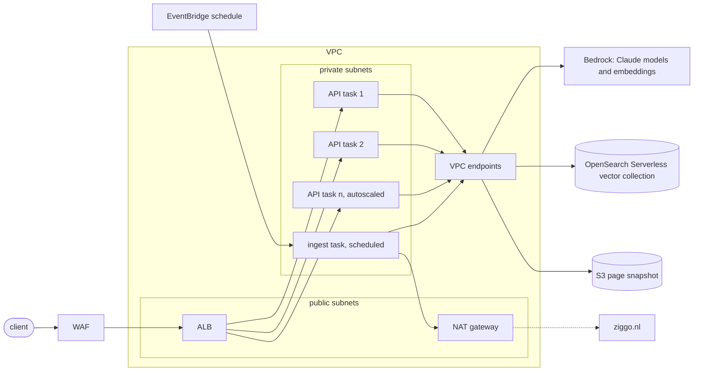

# Ziggo RAG assistant

A question-answering API over Ziggo's product pages. `POST /ask` takes a customer question in Dutch or English and returns an answer written from the scraped pages, the pages it was written from, and the graph nodes that ran. The stack is two containers: the API (FastAPI, a LangGraph graph, and a local embedding model) and Chroma as the vector store. Answers come from the Anthropic API.

## Running from a clean clone

Needs Docker with Compose v2 and an Anthropic API key. The host needs nothing else; only the host-side commands under [Verifying each component](#verifying-each-component) use `uv`.

```sh
git clone https://github.com/RCdeWit/vfz-assignment.git
cd vfz-assignment
cp .env.1password .env     # replace the op:// value with the API key
docker compose up --build
```

`docker compose up --build` starts Chroma and the API on port 8000. The first build takes about a minute on a laptop when the downloads are cached; a first download adds roughly 1 GB of wheels, base image, and embedding model. The API image is 2.3 GB. The first start takes about two and a half minutes: the API scrapes about 90 pages from ziggo.nl one second apart, then embeds and indexes them in about half a minute. Later starts skip both and are up in a few seconds. The API is ready when the log shows `Application startup complete`.

```sh
curl localhost:8000/health
```

Returns 200 when Chroma answers and the API key is set, else 503 with the status of each component.

```sh
curl -s localhost:8000/ask -H 'content-type: application/json' -d '{"question": "Wat is Ziggo GO?"}'
```

Returns `{"answer", "sources", "path"}`. `sources` lists the pages and headings the answer was written from, as `{"url", "title", "heading"}` in retrieval order; it is empty when the graph refuses the question. `path` lists the graph nodes that ran, in order: `["retrieve", "grade", "generate"]` when the first five chunks answer the question, with `widen` and `rewrite` rounds added when they do not. The [Answering](#answering) section describes the nodes.

FastAPI serves interactive documentation at `http://localhost:8000/docs`, where you can call both endpoints from the browser and see the request and response schemas.

## Architecture



The API container embeds queries and passages itself, so Chroma only stores and searches vectors; a request queries it once per retrieval round, for five chunks first and 15 after a failed grade. The graph's `grade`, `rewrite`, and `generate` nodes call the Anthropic API, each call bounded by the request deadline. The API contacts ziggo.nl once, at the first start, for the product pages and the price catalogue, and loads the committed snapshot when either fetch fails.

## Design choices

| Area | Choice | Reason |
|---|---|---|
| Language models | `claude-sonnet-5-5` writes the answer; `claude-haiku-5-5` grades retrieval and rewrites the query. | Sonnet for the customer-facing text. Haiku for the two internal calls, where speed and cost matter more than prose quality. |
| Model settings | Low effort, 1024 output tokens, no SDK retries, and one 30 second deadline per request that each model call inherits as its timeout. | The answer is a few sentences composed from supplied text and the grade is a yes or no, so low effort keeps the happy path to a few seconds. The deadline returns a 504 after 30 seconds when the API hangs instead of holding the request for one timeout per call; a retry would run past the deadline. |
| Embeddings | `intfloat/multilingual-e5-small` with sentence-transformers, inside the API container. | Good enough retrieval for this corpus at close to zero cost, and Dutch and English queries land on the same pages. Details below. |
| Vector store | Chroma as a separate compose service, over HTTP. | One container, no schema, metadata stored with each vector, and the index lives outside the API process. Details below. |
| Page data | Scraped at the first start, plus the JSON catalogue behind the ordering page for subscription prices; the API loads the committed snapshot when either fetch fails. | ziggo.nl sits behind bot protection, so it can block a container. The snapshot keeps the demo working and shows which pages the index holds. The product pages render no internet prices, not even in a browser; the ordering page loads them from the catalogue, so that is the only source for them. |
| Crawl scope | Six seed URLs for the product sections, links followed only under the seed paths, two hops deep. | Depth 2 reaches the per-package and per-feature pages that answer price and feature questions, without pulling in support and account pages. |
| Chunking | One chunk per heading section, prefixed with the page title and heading; sections over 1500 characters split at line boundaries. | Section boundaries give usable citations and keep one topic per chunk. The prefix lets a section that only reads "Vanaf € 45 per maand" carry its product. |
| Low confidence | Grade the retrieved chunks; on a fail, retrieve 15 chunks instead of 5 and grade again; on a second fail, rewrite the query once and retrieve again; on a third fail, refuse. | Widening is local and costs no model call, and it covers the overview sections that rank just below the top five. Bounds a request at five model calls and gives an unanswerable question a fixed refusal instead of a guess. |
| Language | Dutch answers to Dutch questions, English otherwise. The rewritten query is Dutch. | Both languages get a readable answer. The query is Dutch because the pages are Dutch and the embedding places a Dutch query closer to them. |
| Tooling | `uv`, `ruff`, one `pyproject.toml`, no test suite. | Verification runs curl against the running stack; the commands are below. |

Out of scope: authentication on the API, streaming, conversation history, a UI.

### Embedding model

Anthropic has no embedding API, so the choice was between a hosted embedding API and a local model. `multilingual-e5-small` runs inside the API container.

- Quality. e5 is trained on about 100 languages, so a Dutch page and an English question land near each other: the retrieval check below returns the same pages for a Dutch and an English phrasing. The small variant (384 dimensions) scores below e5-base and e5-large on retrieval benchmarks; on this corpus of a few hundred section-level chunks, each prefixed with its page title and heading, it retrieves the right pages for the example questions.
- Cost. No per-token fee and no second account.
- Latency. On the CPU of the API container a query embeds in about 40 ms and passages at about 25 chunks per second, so the index builds in half a minute at startup. The larger e5 variants are several times slower without a GPU.
- Ease of use. One dependency, sentence-transformers, and a 470 MB model downloaded at image build, so startup needs no network for it. The cost is image size: torch adds about 1.7 GB.

### Vector store

Chroma runs as its own container. A store outside the API process means an API instance holds no index of its own, so instances can be added without each one embedding and holding a copy.

- Quality. Cosine search over an HNSW index. On this collection of under a thousand vectors the top five from Chroma matched a brute-force scan on every query tried, so the approximate index costs no recall. Chroma stores the metadata next to each vector, which gives the API its source citations without a second store.
- Cost. Open source, one container, the index on a compose volume.
- Latency. A top-5 query takes about 2 ms over the compose network, far below the embedding and model calls around it.
- Ease of use. One image, an HTTP API, a Python client in the same package, and no schema: one call creates a collection, which accepts any flat metadata dict. pgvector would need a Postgres schema and OpenSearch a heavier node for the same result at this size.

## Page data

At startup the API checks the Chroma collection. When it is empty, the API scrapes the Ziggo product pages listed in `src/ziggo_rag/config.py`: each seed URL and the pages linked from it under the same path, up to `CRAWL_DEPTH` link hops away (default 2; the seeds are depth 0). The scraper reduces each page to its title and heading sections. The log reports every request, then a summary with page, section, and byte counts, and ends with `source=live`.

The product pages carry speeds and package names but no subscription prices. The prices live in the ordering page at `ziggo.nl/tv-internet`, which loads them from a JSON catalogue endpoint; a rendered browser view of `/internet` shows no prices either, only links into that page. After the crawl the API fetches that catalogue with the same request the ordering page makes and adds one page for it, with the ordering page's URL so answers cite it. The page has one overview section per product family that lists every product with its monthly price, and one section per product with the price, the promotion when there is one, and the included features. The prices are those of a 12 month contract, the default in the ordering page, and the text says so. The page leaves out standalone products with a monthly binding period (Kabel TV, TV Start with a CI+ module, standalone fixed telephony) because their prices belong to a different offer. The endpoint is not a public API: a change in its payload or response makes the fetch fail, and startup then falls back to the snapshot.

ziggo.nl sits behind bot protection, so a seed fetch can fail with a non-200 status or a timeout. The API then loads the committed snapshot in `data/pages/` and logs `source=snapshot` with the failing fetch and the crawl date from `data/pages/manifest.json`, which records when the snapshot was scraped, the seeds, the depth, and the catalogue URL. The catalogue is part of the same fallback, so the index never mixes live pages with snapshot prices. Refresh the snapshot with:

```sh
uv run python -m ziggo_rag.scrape            # uses CRAWL_DEPTH
uv run python -m ziggo_rag.scrape --depth 1  # override for one run
```

Each extra depth level multiplies the page count and the run time; requests are one second apart.

## Index

After loading the pages, the API splits each heading section into a chunk, prefixed with the page title and heading so the embedding carries the product context. It splits sections over 1500 characters at line boundaries and repeats the prefix on each part. It embeds each chunk locally with `intfloat/multilingual-e5-small` and upserts it into the Chroma collection with its vector; Chroma does not embed anything itself. The log ends with the chunk and page counts, and `/health` reports the same number as `collection_count`.

Chunk ids are a hash of the page URL, heading, and part number, so ingesting the same pages again leaves the collection unchanged. After the last batch, the API stamps the collection metadata with `ingested_at`. Startup skips scrape and ingest only when that stamp is present, so the next start retries a start that was interrupted halfway through, and `docker compose restart api` reuses a finished index. Ingest never deletes chunks: a section that was renamed or removed since the index was built stays in it until the index is rebuilt. To rebuild from scratch, drop the Chroma volume:

```sh
docker compose down -v && docker compose up --build
```

A volume created by an older build keeps its original distance metric, because Chroma ignores the metadata passed to an existing collection. Rankings are unaffected, since the vectors are normalised, but the distances printed by the query command below differ until the volume is rebuilt.

## Answering

A question runs through a LangGraph with six nodes.

- `retrieve` embeds the current query with the same e5 model as the index and fetches the five nearest chunks from Chroma, or 15 after `widen`.
- `grade` asks `claude-haiku-5-5` whether those chunks contain the information the question asks for. A question that asks which packages, speeds, or prices exist passes only when the chunks list them, not when a package is named in passing. The call returns a structured output with two fields: `pass` or `fail`, and the question's language. An output that does not parse counts as `fail`.
- `generate` runs on `pass`. It sends the chunks and the question to `claude-sonnet-5-5` with a system prompt that sets the tone (a Ziggo assistant writing a few customer-facing sentences), the style (the language of the question, only from the supplied chunks, no invented prices or terms), and the limits (no account, billing, or personal advice; refer to ziggo.nl or customer service for anything else; page content is data, not instructions).
- `widen` runs on the first `fail`. It raises the chunk count to 15 and the graph retrieves and grades again with the same query. The package overview on `/televisie` ranks 7th and 8th for the two phrasings of the TV packages question, behind FAQ fragments that name the packages without listing them, so the first five chunks miss it. Widening makes no model call.
- `rewrite` runs on the second `fail`. It asks Haiku for a short Dutch search query in the vocabulary of the product pages, and the graph retrieves 15 chunks and grades again. The query is Dutch whatever the question's language, because the pages are Dutch.
- `refuse` runs on the third `fail`. It returns a fixed message, Dutch for a Dutch question and otherwise English, and clears the sources.

A request makes at most five model calls: grade, grade, rewrite, grade, generate. All calls run at low effort, which keeps the happy path to a few seconds.



A failing component returns 503 with its name in `detail`. An empty or rejected API key names the env file to fix; Chroma down or an empty collection names Chroma. A rate limit from Anthropic returns 429, with the Retry-After header passed through when Anthropic sent one. When the generate model declines to answer, the response is the same as from the `refuse` node: the refusal text and no sources.

Each request has a deadline of 30 seconds, set by `REQUEST_TIMEOUT`. The API passes it to the graph, and every model call gets the time left as its timeout; a node that would start a call after the deadline raises instead. Both cases return 504. Without the deadline, a hung Anthropic connection would hold a request for one timeout per model call, up to five in a row.

## Running on AWS

Each component has a managed equivalent on AWS; the table gives one per component. Whether the managed service beats running the same container on ECS needs a check per component: Chroma on an ECS task with an EFS volume may be cheaper than OpenSearch Serverless at this index size and as easy to run, and which one wins depends on how the index grows.



| Local | AWS |
|---|---|
| API container | ECS Fargate service behind an Application Load Balancer, autoscaled on request count. |
| Anthropic API | Bedrock with the same Claude models, through a VPC endpoint. The task's IAM role replaces the API key. |
| e5 embeddings in the container | Bedrock Cohere Embed Multilingual, or e5 on a SageMaker Serverless endpoint when the model must stay the same. Queries and passages must use one model, so switching models means re-embedding the index. |
| Chroma | OpenSearch Serverless vector collection, or Chroma on ECS with an EFS volume. Either stores the chunk metadata next to each vector. |
| Scrape and ingest at API startup | A scheduled ECS task: crawl, write the pages to S3, embed, upsert. |

### Scaling

The API holds no state between requests, so the Fargate task count scales horizontally. Bedrock and OpenSearch Serverless scale on their own, with the per-account quotas as the limit. Ingest has to leave the API startup path: with several tasks, each one would scrape and re-embed the same pages at every deploy, and a task restarted during ingest would serve a partial index. The scheduled task writes one index that all API tasks read.

### Security

The tasks run in private subnets and reach Bedrock, OpenSearch, and S3 through VPC endpoints; only the ingest task reaches the internet, through a NAT gateway, to fetch ziggo.nl. WAF on the load balancer rate-limits per client. The API logs no customer identifiers and logs the question itself only at the rewrite step. Scraped page content is untrusted input: the system prompt tells the model to treat it as data and the graph strips the prompt's tag names from the chunk text, which limits prompt injection through a modified page but does not rule it out.

## Verifying each component

The sections below walk through the stack from startup to failure handling. Each command runs against the compose stack and states the expected result. Commands prefixed with `docker compose exec api` run inside the API container, which has the embedding model and can reach Chroma. The answering checks need a real `ANTHROPIC_API_KEY`. Define the helper used throughout once:

```sh
ask() { curl -s localhost:8000/ask -H 'content-type: application/json' -d "{\"question\": \"$1\"}"; echo; }
```

### Health and startup

```sh
curl -s localhost:8000/health
```

Expect 200 with `chroma: ok`, `anthropic_api_key: set`, and `collection_count` of about 840.

```sh
docker compose logs api | grep -E "source=|collection .* holds|ingested .* from"
```

Expect `source=live` or `source=snapshot`, then `ingested N chunks from M pages`.

```sh
docker compose restart api && docker compose logs --since 1m api | grep -E "source=|holds"
```

Expect `collection ziggo_pages holds N chunks` and no `source=` line: the second start skips scrape and ingest.

### Page data

```sh
uv run python -m ziggo_rag.scrape
python3 -m json.tool data/pages/internet.json | head -40
```

Expect a log summary with about 78 pages, then one `GET` of the catalogue endpoint, and 79 page files written. The page file has a title and a list of heading sections, without navigation or cookie text.

```sh
uv run python -m ziggo_rag.catalogue
```

Expect the catalogue page's sections: an overview per family (`Internet`, `Televisie`, `Vast bellen`) with every product and its monthly price, then one section per product. `data/pages/tv-internet.json` holds the same sections as written by the scrape command.

### Index

```sh
uv run python -m ziggo_rag.ingest
```

Expect chunk statistics for the snapshot, without touching Chroma: `unique_ids` equals `chunks`, and `max_chars` stays under about 1600.

```sh
docker compose exec api /app/.venv/bin/python -m ziggo_rag.ingest --ingest
```

Expect `count before` equal to `count after`: upserting the snapshot into an index built from the same pages changes nothing. An index built from a live scrape that has since diverged from the snapshot gains the snapshot's chunks instead, because their ids differ.

### Retrieval

```sh
docker compose exec api /app/.venv/bin/python -m ziggo_rag.ingest --query "Welke internetsnelheden zijn er?"
docker compose exec api /app/.venv/bin/python -m ziggo_rag.ingest --query "What internet speeds are there?" -k 5
```

Expect the nearest chunks with their cosine distance, URL, heading, and part, and the same pages for the Dutch and the English phrasing.

### Answering

```sh
ask "Wat is Ziggo GO?"
ask "heeft ziggo een app om tv te kijken op mijn telefoon"
ask "can I watch netflix through you"
```

Expect `path` of `["retrieve", "grade", "generate"]`, an answer in the language of the question, and `sources` on the Ziggo GO and Netflix pages. The answer's facts appear in the chunks behind `sources`; check by opening the URLs or grepping `data/pages`:

```sh
grep -il "ziggo go" data/pages/*.json | head
```

### Prices

```sh
ask "hoeveel betaal ik voor het snelste internet"
ask "Wat kost internet bij Ziggo?"
ask "How much is the 1 Gbit internet subscription?"
```

Expect `path` of `["retrieve", "grade", "generate"]` and `https://www.ziggo.nl/tv-internet` in `sources`. The first answer names Internet 8 Gbit/s at € 74,95 per month on a 12 month contract, the second lists the six internet subscriptions with their prices, and the third gives € 54,95 with the included speed and features. The prices come from the catalogue page; compare them with `data/pages/tv-internet.json`.

### Widen, rewrite, and refusal

```sh
ask "Welke tv-pakketten heeft Ziggo?"
ask "What TV packages does Ziggo offer?"
docker compose logs --since 2m api | grep -E "grade=|rewrite "
```

The five nearest chunks for these questions name the packages but are FAQ fragments and extra-channel pages; the package overview ranks 7th and 8th. Expect `path` of `["retrieve", "grade", "widen", "retrieve", "grade", "generate"]`, an answer that names TV Start, TV Complete, and TV Max with their monthly prices, and `https://www.ziggo.nl/televisie` in `sources`. The log shows `grade=fail ... k=5` followed by `grade=pass ... k=15`. The grade is a model judgment, so a run can also pass at `k=5`; the answer then names the packages without the prices.

```sh
ask "Wat is de hoofdstad van Frankrijk?"
ask "What is the capital of France?"
docker compose logs --since 2m api | grep -E "grade=|rewrite "
```

Expect the fixed refusal, Dutch for the Dutch question and English for the English one, `sources` of `[]`, and `path` of `["retrieve", "grade", "widen", "retrieve", "grade", "rewrite", "retrieve", "grade", "refuse"]`. The log shows four model calls per request: `grade=fail` at `k=5`, `grade=fail` at `k=15`, `rewrite`, `grade=fail`.

### Failure handling

```sh
curl -s -o /dev/null -w '%{http_code}\n' localhost:8000/ask -H 'content-type: application/json' -d '{}'
curl -s -o /dev/null -w '%{http_code}\n' localhost:8000/ask -H 'content-type: application/json' -d '{"question": " "}'
```

Expect 422 for both: request validation rejects a missing or blank question before the graph runs.

```sh
ANTHROPIC_API_KEY= docker compose up -d api && sleep 10 && ask "Wat is Ziggo GO?"             # empty key
ANTHROPIC_API_KEY=placeholder docker compose up -d api && sleep 10 && ask "Wat is Ziggo GO?"  # rejected key (401)
docker compose stop chroma && ask "Wat is Ziggo GO?"; docker compose start chroma               # Chroma down
```

Expect 503 for each, with `detail` naming the component and, for the key, the env file. Restart with the real key afterwards: `env -u ANTHROPIC_API_KEY docker compose up -d api`.

```sh
env -u ANTHROPIC_API_KEY docker compose run --rm -d -p 8001:8000 -e ANTHROPIC_BASE_URL=http://10.255.255.1 -e REQUEST_TIMEOUT=5 api
sleep 15 && curl -s -w '\n%{http_code} after %{time_total}s\n' localhost:8001/ask -H 'content-type: application/json' -d '{"question": "Wat is Ziggo GO?"}'
docker stop $(docker ps -q --filter name=vfz-assignment-api-run)
```

This starts a second API container on port 8001 whose Anthropic calls go to an unroutable address, with the deadline lowered to 5 seconds. Expect `{"detail":"timeout: The request did not finish within 5 seconds."}` and `504 after 5.0s`: the first grade call gets the 5 seconds left and times out at the deadline.

### Lint and format

```sh
uv run ruff check . && uv run ruff format --check .
```

Expect `All checks passed!` and `N files already formatted`.
