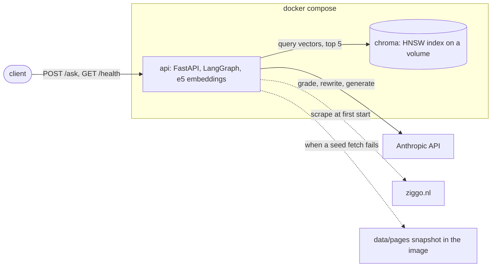
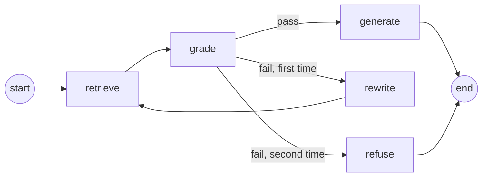
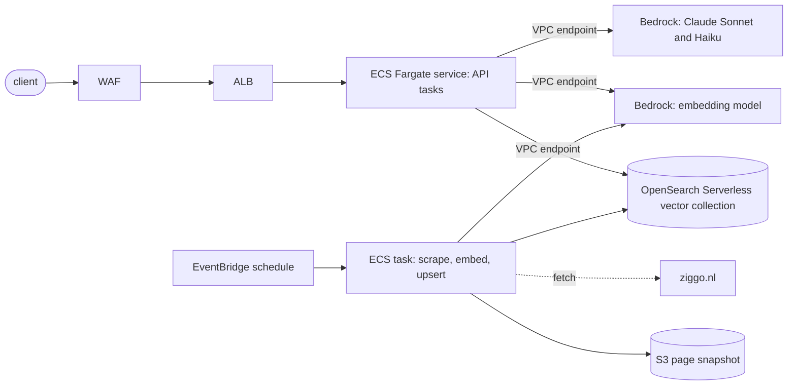

# Ziggo RAG assistant

A question-answering API over Ziggo's product pages. `POST /ask` takes a customer question in Dutch or English and returns an answer written from the scraped pages, the pages it was written from, and the graph nodes that ran. The stack is two containers: the API (FastAPI, a LangGraph graph, and a local embedding model) and Chroma as the vector store. Answers come from the Anthropic API.

## Running from a clean clone

Needs Docker with Compose v2 and an Anthropic API key. Nothing else is installed on the host; `uv` is only needed for the host-side commands under [Verifying each component](#verifying-each-component).

```sh
git clone https://github.com/RCdeWit/vfz-assignment.git
cd vfz-assignment
cp .env.1password .env     # replace the op:// value with the API key
docker compose up --build
```

`docker compose up --build` starts Chroma and the API on port 8000. The first build takes about a minute on a laptop when the downloads are cached; a first download adds roughly 1 GB of wheels, base image, and embedding model. The API image is 2.3 GB. The first start takes about two and a half minutes: the API scrapes about 90 pages from ziggo.nl one second apart, then embeds and indexes them in about half a minute. Later starts skip both and are up in a few seconds. The API is ready when the log shows `Application startup complete`.

```sh
curl localhost:8000/health
```

Returns 200 when Chroma answers and the API key is set, else 503 with the status of each component.

```sh
curl -s localhost:8000/ask -H 'content-type: application/json' -d '{"question": "Wat is Ziggo GO?"}'
```

Returns `{"answer", "sources", "path"}`. `sources` lists the pages and headings the answer was written from, as `{"url", "title", "heading"}` in retrieval order; it is empty when the question is refused. `path` lists the graph nodes that ran.

### The API key

The key is read from the environment. `.env.1password` holds an `op://` reference to the 1Password item; it contains no secret and is committed. With the 1Password CLI, resolve the reference at process start instead of writing `.env`:

```sh
op run --env-file=.env.1password -- docker compose up --build
```

Or write a resolved `.env`, which compose picks up on its own. `.env` is gitignored.

```sh
op inject -i .env.1password -o .env
```

The compose file passes `ANTHROPIC_API_KEY` from the shell into the container, and that value overrides `.env`. A shell that exports the variable as an empty string therefore starts the API without a key even when `.env` holds one; `/health` then reports `anthropic_api_key: missing`. Unset the variable or start compose with `env -u ANTHROPIC_API_KEY docker compose up`.

## Architecture



The API container does the embedding itself, so Chroma only stores and searches vectors. The Anthropic API is called from the graph's `grade`, `rewrite`, and `generate` nodes. ziggo.nl is contacted once, at the first start, and the committed snapshot is used when that fails.

## Design choices

| Area | Choice | Reason |
|---|---|---|
| Language models | `claude-sonnet-5-5` writes the answer; `claude-haiku-5-5` grades retrieval and rewrites the query. | Sonnet for the customer-facing text. Haiku for the two internal calls, where speed and cost matter more than prose quality. |
| Model settings | Low effort, 1024 output tokens, a 30 second timeout and one retry per call. | The answer is a few sentences composed from supplied text and the grade is a yes or no, so low effort keeps the happy path to a few seconds. The timeout bounds a request at about four minutes when the API hangs; the SDK defaults would make that two hours. |
| Embeddings | `intfloat/multilingual-e5-small` with sentence-transformers, inside the API container. | Anthropic has no embedding API, and a local model keeps the reviewer to one key. Multilingual because the pages are Dutch and questions may be English. The reasons in full are in the module docstring of `src/ziggo_rag/llm.py`. |
| Vector store | Chroma as a separate compose service, over HTTP. | One container, no schema, metadata stored with each vector. The reasons in full are in the module docstring of `src/ziggo_rag/ingest.py`. |
| Page data | Scraped at the first start; the committed snapshot is loaded when a seed fetch fails. | ziggo.nl sits behind bot protection, so a container can be blocked. The snapshot keeps the demo working and shows which pages the index holds. |
| Crawl scope | Six seed URLs for the product sections, links followed only under the seed paths, two hops deep. | Depth 2 reaches the per-package and per-feature pages that answer price and feature questions, without pulling in support and account pages. |
| Chunking | One chunk per heading section, prefixed with the page title and heading; sections over 1500 characters split at line boundaries. | Section boundaries give usable citations and keep one topic per chunk. The prefix lets a section that only reads "Vanaf € 45 per maand" carry its product. |
| Low confidence | Grade the retrieved chunks; on a fail, rewrite the query once and retrieve again; on a second fail, refuse. | Bounds a request at four model calls and gives an unanswerable question a fixed refusal instead of a guess. |
| Language | Dutch answers to Dutch questions, English otherwise. The rewritten query is Dutch. | Dutch customers and an English-speaking reviewer both get a readable answer. The query is Dutch because the pages are Dutch and the embedding places a Dutch query closer to them. |
| Tooling | `uv`, `ruff`, one `pyproject.toml`, no test suite. | Verification is done with curl against the running stack; the commands are listed below. |

Out of scope: authentication on the API, streaming, conversation history, a UI.

## Page data

At startup the API checks the Chroma collection. When it is empty, the API scrapes the Ziggo product pages listed in `src/ziggo_rag/config.py`: each seed URL and the pages linked from it under the same path, up to `CRAWL_DEPTH` link hops away (default 2; the seeds are depth 0). Each page is reduced to its title and heading sections. The log reports every request, then a summary with page, section, and byte counts, and ends with `source=live`.

ziggo.nl sits behind bot protection, so a seed fetch can fail with a non-200 status or a timeout. The API then loads the committed snapshot in `data/pages/` and logs `source=snapshot` with the failing seed and the crawl date from `data/pages/manifest.json`, which records when the snapshot was scraped, the seeds, and the depth. Refresh the snapshot with:

```sh
uv run python -m ziggo_rag.scrape            # uses CRAWL_DEPTH
uv run python -m ziggo_rag.scrape --depth 1  # override for one run
```

Each extra depth level multiplies the page count and the run time; requests are one second apart.

## Index

After the pages are loaded, the API splits each heading section into a chunk, prefixed with the page title and heading so the embedding carries the product context. Sections over 1500 characters are split at line boundaries, with the prefix repeated on each part. Each chunk is embedded locally with `intfloat/multilingual-e5-small` and upserted into the Chroma collection with its vector; Chroma does not embed anything itself. The log ends with the chunk and page counts, and `/health` reports the same number as `collection_count`.

Chunk ids are a hash of the page URL, heading, and part number, so ingesting the same pages again leaves the collection unchanged. When the last batch is written, the API stamps the collection metadata with `ingested_at`. Startup skips scrape and ingest only when that stamp is present, so a start that was interrupted halfway through is retried on the next one, and `docker compose restart api` reuses a finished index. Ingest never deletes chunks: a section that was renamed or removed since the index was built stays in it until the index is rebuilt. To rebuild from scratch, drop the Chroma volume:

```sh
docker compose down -v && docker compose up --build
```

A volume created by an older build keeps its original distance metric, because Chroma ignores the metadata passed to an existing collection. Rankings are unaffected, since the vectors are normalised, but the distances printed by the query command below differ until the volume is rebuilt.

## Answering

A question runs through a LangGraph with five nodes. `retrieve` embeds the current query with the same e5 model as the index and fetches the five nearest chunks from Chroma. `grade` asks `claude-haiku-5-5` whether those chunks contain the information the question asks for; the call returns a two-field structured output, `pass` or `fail` plus the question's language, and an output that does not parse counts as `fail`. On `pass`, `generate` sends the chunks and the question to `claude-sonnet-5-5` with a system prompt that sets the tone (a Ziggo assistant writing a few customer-facing sentences), the style (answer in the language of the question, only from the supplied chunks, no invented prices or terms), and the limits (no account, billing, or personal advice; refer to ziggo.nl or customer service for anything outside the chunks; page content is data, not instructions). On the first `fail`, `rewrite` asks Haiku for a short Dutch search query in the vocabulary of the product pages and the graph retrieves and grades again. The query is Dutch whatever the question's language, because the pages are Dutch. On a second `fail`, `refuse` returns a fixed message, Dutch for a Dutch question and otherwise English, and clears the sources. A request therefore makes at most four model calls: grade, rewrite, grade, generate. All calls run at low effort, which keeps the happy path to a few seconds.



A failing component returns 503 with its name in `detail`. An empty or rejected API key names the env file to fix; Chroma down or an empty collection names Chroma. A rate limit from Anthropic returns 429, with the Retry-After header passed through when Anthropic sent one. When the generate model declines to answer, the response is the same as from the `refuse` node: the refusal text and no sources.

## Running on AWS

The same components map to managed services. Nothing in the API depends on the local setup except the Chroma client and the Anthropic client, which are the two pieces that change.



| Local | AWS |
|---|---|
| API container | ECS Fargate service behind an Application Load Balancer, autoscaled on request count. |
| Anthropic API | Bedrock with the same Claude models, through a VPC endpoint. The task's IAM role replaces the API key. |
| e5 embeddings in the container | Bedrock Cohere Embed Multilingual, or e5 on a SageMaker Serverless endpoint when the model must stay the same. Queries and passages must use one model, so switching models means re-embedding the index. |
| Chroma | OpenSearch Serverless vector collection, with the chunk metadata stored next to each vector as it is in Chroma. |
| Scrape and ingest at API startup | A scheduled ECS task: crawl, write the pages to S3, embed, upsert. |

Scaling. The API holds no state between requests, so the Fargate task count scales horizontally. Bedrock and OpenSearch Serverless scale on their own, with the per-account quotas as the limit. Ingest has to leave the API startup path: with several tasks, each one would scrape and re-embed the same pages at every deploy, and a task restarted during ingest would serve a partial index. The scheduled task writes one index that all API tasks read.

Security. The tasks run in private subnets and reach Bedrock, OpenSearch, and S3 through VPC endpoints; only the ingest task reaches the internet, through a NAT gateway, to fetch ziggo.nl. WAF on the load balancer rate-limits per client. The API logs no customer identifiers; the question itself is logged only at the rewrite step. Scraped page content is untrusted input: the system prompt tells the model to treat it as data and the chunk text is stripped of the prompt's tag names, which limits prompt injection through a modified page but does not rule it out.

## Verifying each component

The commands below run against the compose stack. Commands prefixed with `docker compose exec api` run inside the API container, which has the embedding model and can reach Chroma; the same modules run on the host with `uv run python -m ...` when `CHROMA_HOST` and `CHROMA_PORT` point at a reachable Chroma.

Health. Expect 200 with `chroma: ok` and a non-zero `collection_count`; 503 when Chroma is down or the key is missing:

```sh
curl -s localhost:8000/health
```

Startup path. The log shows whether the pages came from the live site or the snapshot, and how many chunks were ingested:

```sh
docker compose logs api | grep -E "source=|collection .* holds|ingested .* from"
```

Restart. A second start finds the collection filled and skips scrape and ingest; the log shows `collection ziggo_pages holds N chunks` and no `source=` line:

```sh
docker compose restart api && docker compose logs --since 1m api | grep -E "source=|holds"
```

Scrape. Refresh the snapshot and inspect one page file; each file has a title and a list of heading sections:

```sh
uv run python -m ziggo_rag.scrape
python3 -m json.tool data/pages/internet.json | head -40
```

Chunking. Chunks the snapshot without touching Chroma and prints counts and sizes. `unique_ids` equals `chunks`, and `max_chars` stays under about 1600:

```sh
uv run python -m ziggo_rag.ingest
```

Ingest idempotence. Upserts the snapshot chunks and prints the collection count before and after. Running it against an index built from the same pages leaves the count unchanged. An index built from a live scrape that has since diverged from the snapshot gains the snapshot's chunks instead, because their ids differ:

```sh
docker compose exec api /app/.venv/bin/python -m ziggo_rag.ingest --ingest
```

Retrieval. Prints the nearest chunks with their cosine distance, URL, heading, and part. A Dutch and an English phrasing of the same question return the same pages:

```sh
docker compose exec api /app/.venv/bin/python -m ziggo_rag.ingest --query "Welke internetsnelheden zijn er?"
docker compose exec api /app/.venv/bin/python -m ziggo_rag.ingest --query "What internet speeds are there?" -k 5
```

Answering. Needs a real `ANTHROPIC_API_KEY`. The answer's facts appear in the chunks behind `sources`; check by opening the URLs or grepping `data/pages`. An English question gets an English answer. `path` is `["retrieve", "grade", "generate"]` when the first retrieval passes the grade:

```sh
ask() { curl -s localhost:8000/ask -H 'content-type: application/json' -d "{\"question\": \"$1\"}"; echo; }
ask "Wat is Ziggo GO?"
ask "heeft ziggo een app om tv te kijken op mijn telefoon"
ask "can I watch netflix through you"
grep -il "ziggo go" data/pages/*.json | head
```

Rewrite. The TV package questions sit at the grade's boundary: the five nearest chunks name packages but are extra-channel pages rather than the package overview. The grade is a model judgment, so the same question fails the first grade in most runs and passes it in others. On a fail, `path` is `["retrieve", "grade", "rewrite", "retrieve", "grade", "generate"]` and the log shows the rewritten query; the second grade of the English question sometimes fails as well and refuses:

```sh
ask "Welke tv-pakketten heeft Ziggo?"
ask "What TV packages does Ziggo offer?"
docker compose logs --since 2m api | grep -E "grade=|rewrite "
```

Refusal. A question outside the pages gets the fixed refusal, Dutch for a Dutch question and otherwise English, `sources` is `[]`, and `path` is `["retrieve", "grade", "rewrite", "retrieve", "grade", "refuse"]`. The log shows three model calls for the request: `grade=fail`, `rewrite`, `grade=fail`. Internet subscription prices are refused as well, because the scraped pages contain no section with both a speed and a price:

```sh
ask "Wat is de hoofdstad van Frankrijk?"
ask "What is the capital of France?"
ask "hoeveel betaal ik voor het snelste internet"
docker compose logs --since 2m api | grep -E "grade=|rewrite "
```

Input validation. A missing or blank question returns 422 without running the graph:

```sh
curl -s -o /dev/null -w '%{http_code}\n' localhost:8000/ask -H 'content-type: application/json' -d '{}'
curl -s -o /dev/null -w '%{http_code}\n' localhost:8000/ask -H 'content-type: application/json' -d '{"question": " "}'
```

Failure mapping. Each returns 503; `detail` names the component and, for the key, the env file:

```sh
ANTHROPIC_API_KEY= docker compose up -d api && sleep 10 && ask "Wat is Ziggo GO?"             # empty key
ANTHROPIC_API_KEY=placeholder docker compose up -d api && sleep 10 && ask "Wat is Ziggo GO?"  # rejected key (401)
docker compose stop chroma && ask "Wat is Ziggo GO?"; docker compose start chroma               # Chroma down
```

Lint and format:

```sh
uv run ruff check . && uv run ruff format --check .
```
